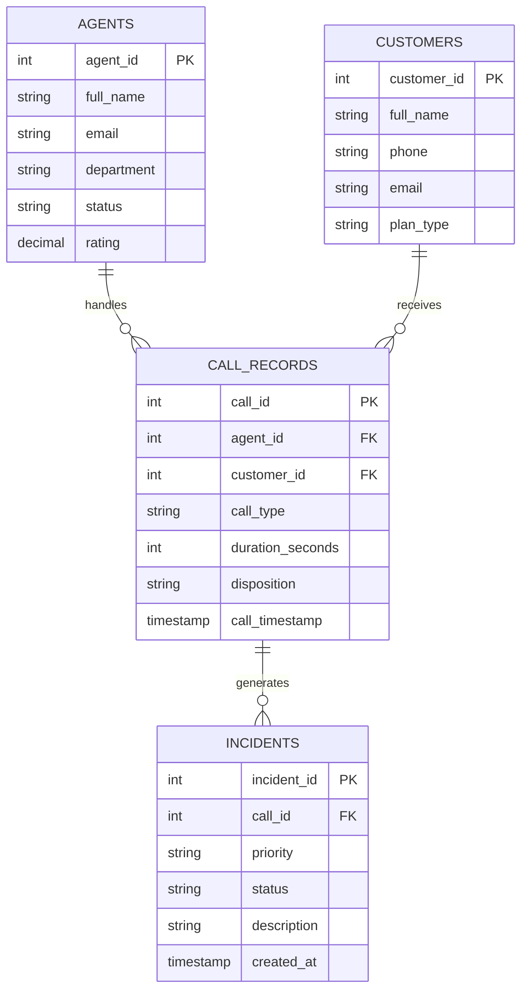

# 📞 NexusCall — Call Center Management System & DBMS Simulator

[](https://www.oracle.com/java/)
[](https://spring.io/projects/spring-boot)
[](https://www.postgresql.org/)
[](https://github.com/brettwooldridge/HikariCP)
[](https://developer.mozilla.org/en-US/docs/Web/JavaScript)
[](LICENSE)

An enterprise-grade **Call Center Relational Database Management System** and interactive **JDBC/ODBC lab simulation platform**. 

NexusCall allows users to manage call records, agents, customers, and incidents through an interactive web portal backed by a dual runtime: a full **Java Spring Boot 3.2** native JDBC repository with HikariCP connection pooling, alongside a zero-dependency **Node.js** web/REST server with live SQL query execution and schema management.

---

## 🌟 Key Features

- **📊 Comprehensive Relational Schema**: Normalized tables for `agents`, `customers`, `call_records`, and `incidents` with foreign keys, constraints, and cascade rules.
- **⚡ Dual-Runtime Architecture**:
  - **Java Spring Boot Backend**: Production-ready backend using native JDBC `PreparedStatement`, `Statement`, `ResultSet`, and HikariCP connection pool with PostgreSQL / embedded H2 support.
  - **Zero-Dependency Node.js Server**: Instant local runtime that serves the web UI and provides `/api/sql/execute` and `/api/tables/*` REST endpoints without needing external npm modules.
- **💻 Interactive SQL Console**: Execute arbitrary `DDL`, `DML`, and `DQL` commands with syntax highlighting, live query latency profiling, and dynamic tabular result visualization.
- **🔄 JDBC & ODBC Lab Simulator**: Visual step-by-step trace of Java JDBC lifecycle (`DriverManager` ➔ `Connection` ➔ `Statement` ➔ `ResultSet` ➔ `Close`).
- **🛡️ Transaction Management & Rollback**: Built-in support for transactions, commit points, and rollback operations.
- **🎨 Modern Web UI**: Responsive, glassmorphic dark-mode interface with toast notifications, data tables, and modal editors.

---

## 🗄️ Database Schema

The relational schema models real-world call center operations:



---

## 🚀 Quick Start

### Option 1: Quick Run via Batch Script (Windows)

Simply double-click:
```cmd
start_server.bat
```
This launches the web server and automatically opens `http://localhost:3000` in your default browser.

---

### Option 2: Run via Node.js Server

```bash
# Start server (no npm install required - uses native Node.js standard library)
node server.js
```
Then visit **`http://localhost:3000`**.

---

### Option 3: Run the Java Spring Boot JDBC Backend

```bash
# Navigate to backend directory
cd backend

# Build and run with Maven
mvn clean spring-boot:run
```
The Spring Boot backend will start on port `8080` with native JDBC HikariCP connection pooling connected to PostgreSQL or embedded H2.

---

## 📁 Project Structure

```text
├── index.html                 # Main Call Center portal interface
├── styles.css                 # Modern CSS styles and responsive layout
├── app.js                    # Frontend UI logic and API communication
├── database.js               # SQL engine and local relation store
├── jdbcSimulator.js          # Interactive JDBC/ODBC lifecycle simulator
├── seedData.js               # Initial database records & sample dataset
├── server.js                 # Zero-dependency Node.js REST & static server
├── start_server.bat          # 1-click Windows launcher
├── schema.sql                # Complete PostgreSQL DDL definitions
├── data.sql                  # Seed data DML insertion scripts
├── backend/                  # Java Spring Boot Native JDBC Application
│   ├── pom.xml               # Maven dependencies (HikariCP, PostgreSQL, H2)
│   └── src/
│       └── main/
│           ├── java/com/nexuscall/
│           │   ├── NexusCallApplication.java
│           │   ├── config/DatabaseConfig.java
│           │   ├── controller/ (CallCenterController, SqlConsoleController)
│           │   ├── model/ (Agent, Customer, CallRecord, Incident, SqlRequest)
│           │   └── repository/ (CallCenterJdbcRepository, SqlExecutionRepository)
│           └── resources/
│               ├── application.properties
│               ├── schema.sql
│               └── data.sql
└── .gitignore                # Git exclusions (build targets, logs, caches)
```

---

## 🛠️ Tech Stack

- **Frontend**: HTML5, Vanilla CSS3, Modern JavaScript (ES6+), Fetch API
- **Backend (Node.js)**: Node.js Native HTTP & File System modules
- **Backend (Java)**: Java 17, Spring Boot 3.2, HikariCP Connection Pool
- **Database**: PostgreSQL 16 / H2 Database, Native Core JDBC
- **Simulations**: ODBC/JDBC Connection Lifecycle Driver Visualizer

---

## 📄 License

This project is licensed under the MIT License.
